# recomp2jam

A clean-room **recompilation of the O2Jam 7.55 client in Rust** — and the
reference implementation of 7.55 behavior: every shipped behavior traces to
pinned evidence against the original executable (the behavior oracle) or is
explicitly labeled OPEN with its next evidence step.

The original client was C++ (MSVC 2005) on the **CDX** library, **Boost
~1.35/1.37**, and **libvorbis**. This project re-implements that client in
safe, portable Rust — no original code or binaries are included.

> ⚠️ Clean-room note: you must supply your own legally obtained O2Jam 7.55
> install. Never commit the original `.exe`, `.ojm`, `.ojn`, or other
> copyrighted assets (git-ignored by default; see
> [`AGENTS.md`](AGENTS.md)).

## Status

The client **runs today**: windowed boot → planet board → channel → rooms →
waiting → loading → playing → result, plus the shop, MyRoom, payment, options,
and dialog families, driven by the original archive formats through pure-Rust
parsers. Behavior is pinned by ~2,900 scenario-named guards (live-path
regression tests), with the 7.55 executable as oracle.

## Screenshots

Rendered by this client from the current build (regenerate with
`cargo run -p recomp2jam --bin recomp2jam -- shots --out-dir docs/screenshots`,
after `scripts/worktree-setup.sh`; the `-native` and `reference-*` variants
pair with original-client captures in the same directory):

| | | |
|---|---|---|
|  |  | 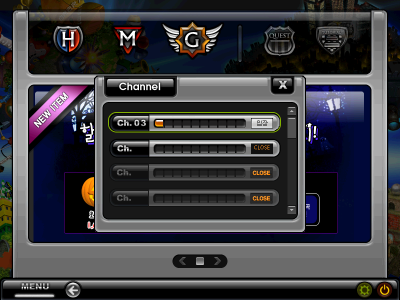 |
| 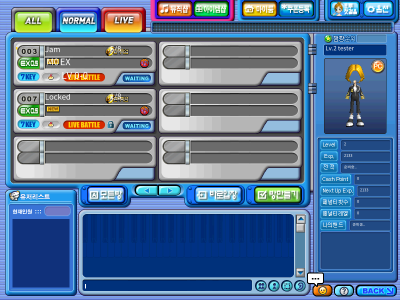 | 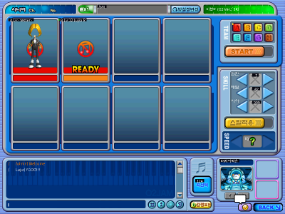 | 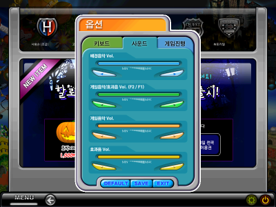 |
| 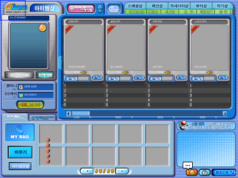 | 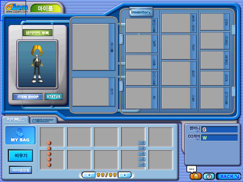 | 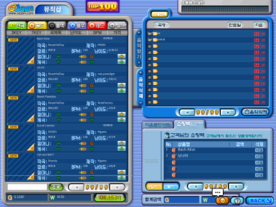 |
| 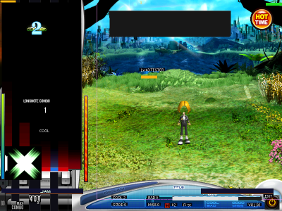 |  | 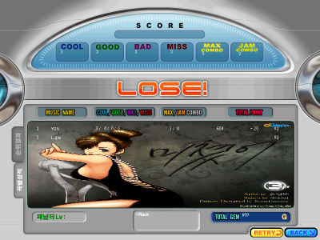 |
| 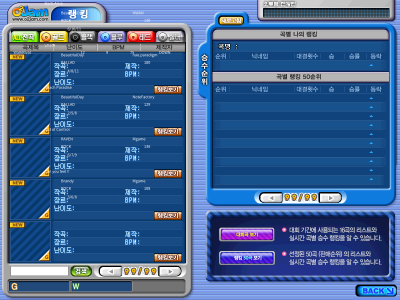 | 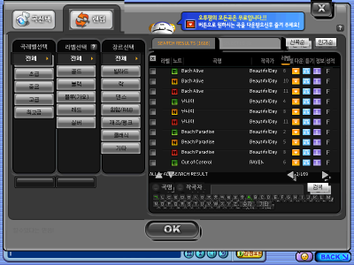 | 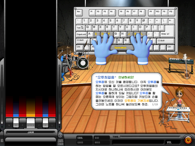 |

## Feature progress

Live from the [issue tracker](https://github.com/ar-nim/recomp2jam/issues) —
badges are GitHub search queries against feature labels, so this section
**cannot diverge** from the tracker. Open = work remaining, done = closed.

**Boot & board:**


**Lobbies:**


**Gameplay:**


**Economy & sides:**


**System:**


Specs (story matrices, one per feature):
[#287 Avi](https://github.com/ar-nim/recomp2jam/issues/287) ·
[#288 Planet](https://github.com/ar-nim/recomp2jam/issues/288) ·
[#289 Channel](https://github.com/ar-nim/recomp2jam/issues/289) ·
[#290 Room](https://github.com/ar-nim/recomp2jam/issues/290) ·
[#291 Waiting](https://github.com/ar-nim/recomp2jam/issues/291) ·
[#292 Loading](https://github.com/ar-nim/recomp2jam/issues/292) ·
[#293 Playing](https://github.com/ar-nim/recomp2jam/issues/293) ·
[#294 Result](https://github.com/ar-nim/recomp2jam/issues/294) ·
[#178 Item Shop](https://github.com/ar-nim/recomp2jam/issues/178) ·
[#179 Music Shop](https://github.com/ar-nim/recomp2jam/issues/179) ·
[#180 MyRoom](https://github.com/ar-nim/recomp2jam/issues/180) ·
[#296/#297 Payment](https://github.com/ar-nim/recomp2jam/issues/296) ·
[#313 Tutorial](https://github.com/ar-nim/recomp2jam/issues/313) ·
[#314 Options](https://github.com/ar-nim/recomp2jam/issues/314) ·
[#315 Messenger](https://github.com/ar-nim/recomp2jam/issues/315) ·
[#316 Dialogs](https://github.com/ar-nim/recomp2jam/issues/316)

## Layout

```text
crates/
  o2jam-file      # .ojm / .ojn parsers (pure Rust)
  o2jam-audio     # Vorbis decode (lewton) + backend trait
  o2jam-net       # the 7.55 wire protocol (framing, opcodes, bodies)
  o2jam-render    # pixel formats, blits, figure decode
  o2jam-text      # text rasterization (OFL fonts; exe pins geometry)
  o2jam-game      # timing, judgement, score, chart model
  o2jam-shell     # ScreenGame: scenes, staging, painters, input
  input-drive     # scripted input/replay driver
  di-interposer   # DirectInput stand-in feeding scripted keys to the exe
  recomp2jam      # the game client binary
  o2jam-dump      # CLI inspector for .ojm/.ojn files
docs/             # evidence, parity verdicts, file formats, agent playbooks
fixtures/         # small synthetic test files only — no copyrighted data
scripts/          # gates, rig, tracker, provenance tooling
```

See [`docs/architecture.md`](docs/architecture.md) for the crate map and
[`docs/original-stack.md`](docs/original-stack.md) for the RE notes
(MSVC 2005 mangling, Boost internals, CDX surface model).

## Quick start

```sh
bash scripts/worktree-setup.sh     # claim a data slot + symlink install-root/
bash scripts/gate-check.sh         # fmt + clippy + tests (both data arms) + push
bash scripts/gate-check.sh --arm quick   # CI's fast arm
bash scripts/gate-check.sh --arm hidden  # CI's no-data arm
cargo run -p recomp2jam -- --help  # client CLI (headless walks, shots, windowed)
scripts/play-local.sh              # windowed client against local Memoryer
```

## Roadmap

- [x] Workspace with verified `.ojm`/`.ojn` parsers and dump tooling
- [x] The 7.55 wire protocol against a local server (Memoryer interop)
- [x] Windowed client: boot → board → lobby → playing → result
- [x] Shop, MyRoom, payment, options, and dialog families
- [ ] Behavior parity to 100% of pinned spec stories — the tracker above
- [ ] Judged-input replay parity (exe injection via the DI interposer)
- [ ] Modern renderer (wgpu) behind the current painter seam

## Contributing

See [CONTRIBUTING.md](CONTRIBUTING.md) and [`AGENTS.md`](AGENTS.md). RE
findings go in `docs/` as small, reviewable PRs — behavior described in our
own words with addresses and evidence IDs, never pasted disassembly.
Everything is relative to **7.55** unless stated otherwise.
